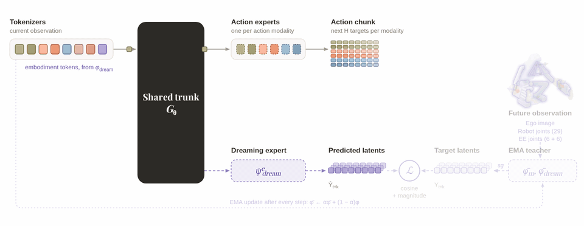
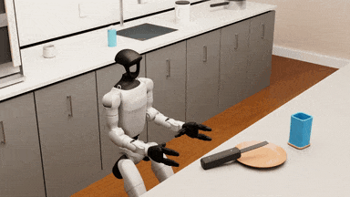
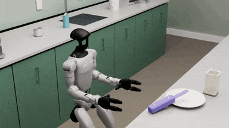
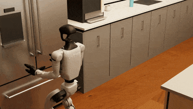

<h1 align="center">
  EgoX: Egocentric Cross-Embodiment<br>
  Manipulation with Embodiment Dreaming
</h1>

<p align="center">
  EgoX team
</p>

<p align="center">
  <sup>1</sup>Carnegie Mellon University &nbsp; <sup>2</sup>Bosch Center for Artificial Intelligence<br>
  <sup>3</sup>The University of Texas at Arlington &nbsp; <sup>4</sup>University of California, Berkeley &nbsp; <sup>5</sup>NVIDIA
</p>

<p align="center">
  <a href="https://egox-dream.github.io/assets/egox.pdf">paper</a> | <a href="https://egox-dream.github.io/">website</a>
</p>

<p align="center">
  <a href="media/egox_teaser.gif">
    
  </a>
</p>

## Overview

**EgoX** is an egocentric cross-embodiment framework for robot manipulation. It
pretrains a **Modularized Cross-Embodiment Transformer with Embodiment Dreaming
(MXT+)** on a mixture of human videos, simulated robot demonstrations, and real
robot demonstrations, then fine-tunes the model on a specific target robot–task pair.

This codebase will provide the following key implementations of EgoX:

1. **Unified data collection:** A shared pipeline for collecting human videos and
   demonstrations from simulated and real robots *(not yet released)*.
2. **MXT+ training:** A training pipeline for the proposed model, including
   cross-embodiment pretraining and target robot–task fine-tuning.
3. **Policy rollout and evaluation:** Deployment of trained policies and evaluation
   of their task performance.

## Getting Started

Clone the repository:

```bash
git clone https://github.com/chrisyrniu/egox.git
cd egox
```

**Datasets and the VR data-collection pipeline are not yet released.** Training
requires compatible demonstrations; deployment requires a checkpoint. Please Run all commands from the
repository root with Conda installed.

### Installation

Choose one setup. **Without `--sim`**, install the environment for training and
policy inference:

```bash
bash scripts/setup_conda_policy.sh --name egox
conda activate egox
```

For RTX 50-series GPUs, prefix the policy-only setup command with
`EGOX_TORCH_INDEX_URL=https://download.pytorch.org/whl/cu130` to use
[CUDA 13.0 wheels](https://pytorch.org/blog/pytorch-2-12-release-blog/)
(Linux NVIDIA driver ≥ 580.65.06).

**With `--sim`**, also install Isaac Sim, Isaac Lab, and the G1 control stack for
simulation rollout and evaluation:

```bash
bash scripts/setup_conda_policy.sh --sim --name egox
conda activate egox
```

Use `--name NAME` (or `-n NAME`) to choose the environment name in either mode,
then activate that same name. 

See [simulation scenes and viewers](examples/README.md) and
[robot assets](assets/README.md) for details.

### Training

The examples below target `G1-Sim-Dex3/Kitchen-Bread`. Set your dataset root;
embodiment configurations are selected from the data. Recipes enable W&B logging;
append `--no-wandb` to disable it.

```bash
export DATA_DIR=/path/to/dataset
```

**Pretraining:** learn from the cross-embodiment mixture, excluding the target
`G1-Sim-Dex3/Kitchen-Bread` pair while retaining Bread data from other embodiments.

```bash
bash scripts/training_scripts/G1-Sim-Dex3/kitchen-Bread/pretrain.sh
```

**Fine-tuning:** adapt a pretrained checkpoint to the target task.

```bash
bash scripts/training_scripts/G1-Sim-Dex3/kitchen-Bread/finetune.sh \
    /path/to/pretrained/policy_last.ckpt
```

**Training from scratch:** train on the target task without pretrained weights.

```bash
bash scripts/training_scripts/G1-Sim-Dex3/kitchen-Bread/train-from-scratch.sh
```

See [training recipes](scripts/training_scripts/README.md) and
[model and robot configurations](src/egox/configs/README.md) for details.

<p align="center">
  
</p>

### Deployment

For **G1-Sim-Dex3**, use the environment created with `--sim` and download the robot
assets once. Set `--model_path` to a training run containing `policy_last.ckpt`,
`all_configs.json`, and `dataset_stats.pkl`.

```bash
python scripts/download_assets.py

# Interactive rollout: press 2 to start the policy.
bash scripts/rollout_scripts/G1-Sim-Dex3/kitchen-Bread/interactive.sh \
    --model_path /path/to/training/run

# Headless benchmark evaluation.
bash scripts/rollout_scripts/G1-Sim-Dex3/kitchen-Bread/headless.sh \
    --model_path /path/to/training/run
```

See [rollout and evaluation options](scripts/rollout_scripts/README.md).
Real-robot deployment requires an embodiment-specific
[controller integration](src/egox/robots/README.md).

**G1-Sim-Dex3 with MXT+ (w/ pretrain).**

<table align="center">
  <tr>
    <td align="center">
      <br>
      <b>Kitchen-Cleanup · ID</b>
    </td>
    <td align="center">
      <br>
      <b>Kitchen-Cleanup · OOD</b> 
    </td>
  </tr>
  <tr>
    <td align="center">
      <br>
      <b>Kitchen-Bread · ID</b> 
    </td>
    <td align="center">
      <br>
      <b>Kitchen-Bread · OOD</b>
    </td>
  </tr>
</table>

## Code Structure

```text
egox/
├── src/egox/               # Core Python package
│   ├── configs/            # Embodiment modalities, model settings, and configuration loading
│   ├── data/               # HDF5 episode loading, normalization, masks, and embodiment sampling
│   ├── models/             # MXT+ tokenizers, shared Transformer, action experts, and dreaming heads
│   ├── training/           # Optimization, validation, logging, and checkpoint saving/resuming
│   ├── inference/          # Policy loading, observation preprocessing, and action rollout
│   ├── robots/             # DDS interfaces, G1 simulation controller, and robot environment
│   └── sim/                # Shared scene setup, state restoration, and interactive viewers
├── scripts/                # Setup, training, and rollout entry points
│   ├── training_scripts/   # Pretraining, fine-tuning, and training from scratch
│   └── rollout_scripts/    # Interactive rollout and benchmark evaluation
├── examples/
│   └── kitchen/            # Simulation scenes, tasks, and benchmarks
├── assets/
│   └── robots/             # Robot models and controller assets
├── media/                  # README figures and animations
└── third_party/
    └── IsaacLab/           # Simulation dependency
```

## To-do List

### Code Implementation

- [x] Model implementation (MXT+ and embodiment dreaming)
- [x] Policy rollout and evaluation (G1-Sim-Dex3)
- [ ] VR data-collection pipeline
- [ ] Example dataset and checkpoint

### Supported Embodiments

Training configurations are included for all seven embodiments. The checklist
tracks deployment and data-collection integrations:

- [x] G1-Sim-Dex3 — simulation rollout and evaluation
- [ ] G1-Dex5 — real-robot deployment
- [ ] xArm7-Dex4 — real-robot deployment
- [ ] Z1-Tool — real-robot deployment
- [ ] LocoMan-Dex2 — real-robot deployment
- [ ] R1Lite-Gripper — real-robot deployment
- [ ] Human-Dex5 — VR data collection

## Acknowledgements

We thank the authors of the following projects:

- **Model:** MXT+ builds on MXT from [Human2LocoMan](https://github.com/chrisyrniu/Human2LocoMan).
- **Whole-body control:** We use the whole-body controller from [HTD](https://github.com/chrisyrniu/humanoid-touch-dream) for both simulated and real humanoids.
- **Apple Vision Pro teleoperation:** Our teleoperation pipeline uses [VisionProTeleop](https://github.com/Improbable-AI/VisionProTeleop) to stream data from Apple Vision Pro.
- **Pico data collection:** Our Pico data-collection pipeline builds on [Unitree XR Teleoperate](https://github.com/unitreerobotics/xr_teleoperate).
