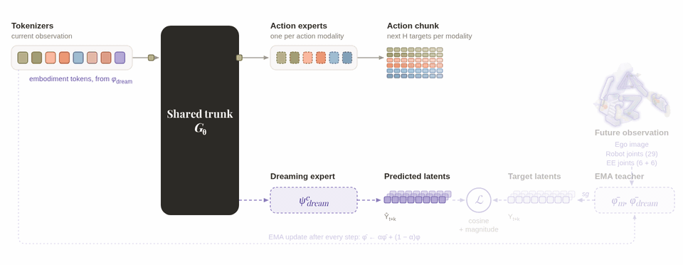
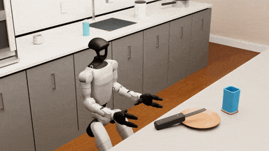
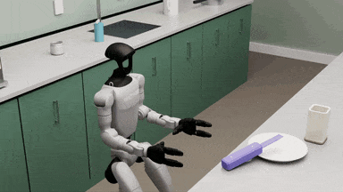
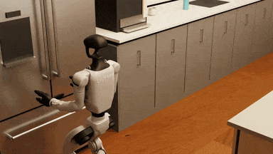
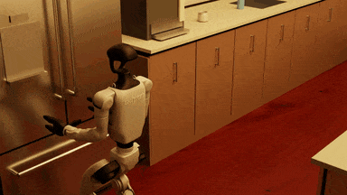

<h1 align="center">
  EgoX: Egocentric Cross-Embodiment<br>
  Manipulation with Embodiment Dreaming
</h1>

<p align="center">
  EgoX team
</p>

<p align="center">
  <sup>1</sup>Carnegie Mellon University &nbsp; <sup>2</sup>Bosch Center for Artificial Intelligence<br>
  <sup>3</sup>The University of Texas at Arlington &nbsp; <sup>4</sup>University of California, Berkeley &nbsp; <sup>5</sup>NVIDIA
</p>

<p align="center">
  <a href="https://arxiv.org/pdf/2611.16728">paper</a> | <a href="https://egox-dream.github.io/">website</a> | <a href="https://huggingface.co/datasets/binghong0727/egox">dataset</a>
</p>

<p align="center">
  <a href="media/egox_teaser.gif">
    
  </a>
</p>

## Overview

**EgoX** is an egocentric cross-embodiment framework for robot manipulation. It
pretrains a **Modular Embodiment Dreamer (MED)** on a mixture of human videos,
simulated robot demonstrations, and real robot demonstrations, then fine-tunes the
model on a specific target robot–task pair.

This codebase will provide the following key implementations of EgoX:

1. **Unified data collection:** A shared pipeline for collecting human videos and
   demonstrations from simulated and real robots
2. **MED training:** A training pipeline for the proposed model, including
   cross-embodiment pretraining and target robot–task fine-tuning.
3. **Policy rollout and evaluation:** Deployment of trained policies and evaluation
   of their task performance.

## Getting Started

Clone the repository:

```bash
git clone https://github.com/egox-dream/egox.git
cd egox
```

### Installation

Run the setup script to create a Conda environment and install all dependencies, including third-party tools:

```bash
bash scripts/setup.sh --sim --PICO-teleop --name egox
conda activate egox
```

Use `--sim` to enable simulation and `--PICO-teleop` to enable PICO teleoperation.

### Download Data

Download the training datasets from Hugging Face in HDF5 format:

```bash
# Download all tasks for a specific embodiment.
python scripts/download_data.py --embodiment g1-sim-dex3
```

Supported embodiments: `g1-dex5`, `g1-sim-dex3`, `human-dex5`, `locoman-dex2`,
`r1lite-gripper`, `xarm7-dex4`, and `z1-tool`.

Omit `--embodiment` to download all embodiments. Use `--output-dir PATH` to choose
a download directory.

### Training

The examples below target Kitchen-Bread with G1-Sim-Dex3. Recipes use this repository's
`data/` folder by default, matching the downloader. For a custom download location,
set `DATA_DIR` to that same root:

```bash
export DATA_DIR=/path/to/egox-data
```

Dataset directories use lowercase embodiment and task names, for example
`data/g1-sim-dex3/kitchen-bread/train/`. Use this same layout for existing local
datasets. Embodiment configurations are selected from the data. Recipes enable
W&B logging; append `--no-wandb` to disable it.

**Pretraining:** learn from the cross-embodiment mixture, excluding the target
`G1-Sim-Dex3/Kitchen-Bread` pair while retaining Bread data from other embodiments.
Download all embodiments before running this recipe.

```bash
bash scripts/training_scripts/g1-sim-dex3/kitchen-bread/pretrain.sh
```

**Fine-tuning:** adapt a pretrained checkpoint to the target task.

```bash
bash scripts/training_scripts/g1-sim-dex3/kitchen-bread/finetune.sh \
    /path/to/pretrained/policy_last.ckpt
```

**Training from scratch:** train on the target task without pretrained weights.

```bash
bash scripts/training_scripts/g1-sim-dex3/kitchen-bread/train-from-scratch.sh
```

See [training recipes](scripts/training_scripts/readme.md) and
[model and robot configurations](src/egox/configs/README.md) for details.

<p align="center">
  
</p>

### Deployment

For **G1-Sim-Dex3**, use the environment created with `--sim`. The
[robot simulation assets](assets/README.md) are included in the repository.
Set `--model_path` to a training run containing `policy_last.ckpt`,
`all_configs.json`, and `dataset_stats.pkl`.

```bash
# Interactive rollout: press 2 to start the policy.
bash scripts/rollout_scripts/g1-sim-dex3/kitchen-bread/interactive.sh \
    --model_path /path/to/training/run

# Headless benchmark evaluation.
bash scripts/rollout_scripts/g1-sim-dex3/kitchen-bread/headless.sh \
    --model_path /path/to/training/run
```

See [rollout and evaluation options](scripts/rollout_scripts/readme.md).
Real-robot deployment requires an embodiment-specific
[controller integration](src/egox/robots/README.md).

**G1-Sim-Dex3 with MED (w/ pretrain).**

<table align="center">
  <tr>
    <td align="center">
      <br>
      <b>Kitchen-Cleanup · ID</b>
    </td>
    <td align="center">
      <br>
      <b>Kitchen-Cleanup · OOD</b> 
    </td>
  </tr>
  <tr>
    <td align="center">
      <br>
      <b>Kitchen-Bread · ID</b> 
    </td>
    <td align="center">
      <br>
      <b>Kitchen-Bread · OOD</b>
    </td>
  </tr>
</table>

### Collect Demonstrations

Collect **G1-Sim-Dex3** demonstrations with PICO for Kitchen-Bread or
Kitchen-Cleanup using a headset and two controllers; body trackers are not required.

1. Install the official [XRoboToolkit PICO 1.1.1 APK](https://github.com/XR-Robotics/XRoboToolkit-Unity-Client/releases/download/v1.1.1/XRoboToolkit-PICO-1.1.1.apk)
   on the headset. 

2. Start the PC service in one terminal and leave it running:

   ```bash
   bash scripts/data_collect_scripts/run_pico_service.sh
   ```

3. Start collection in a second terminal with the PC and PICO on the same network.
   Set `--pico_host` to the **headset's IP** (`PICO_IP`), found in its Wi-Fi connection
   details. Run `ip route get PICO_IP` on the PC; the address after `src` is **PC_IP**,
   used for both **PC Service IP** and **Camera Source IP** in XRoboToolkit.

   For Cleanup, use `kitchen-cleanup` instead of `kitchen-bread` in both the collection
   and rendering commands. Collection is headless by default.

   ```bash
   conda activate egox
   bash scripts/data_collect_scripts/g1-sim-dex3/kitchen-bread/collect.sh --pico_host PICO_IP
   ```

4. Open XRoboToolkit on the headset and configure:

   - **PC Service IP:** enter **PC_IP** and connect to the service.
   - **Tracking:** enable **Head**, **Controller**, and **Send**; set **PICO Motion Tracker Mode**
     to **None** and disable **Switch w/ A Button**.
   - **Remote Vision:** select **ZEDMINI / H.264**. Once the terminal shows `X: reset | A: calibrate...`,
     select **Listen**, enter **PC_IP** as **Camera Source IP**, and confirm.

   Simulator startup can take several minutes. The terminal's `PICO video first frame sent`
   message confirms that video is being sent; check that the ego camera view appears
   before starting. If the stream was disconnected, turn **Listen** off and on to reconnect.

Move the controllers to position the robot's hands, squeeze the triggers to grasp,
use the left stick to move, and the right stick to turn.

| Button | Function |
| --- | --- |
| X | Reset the scene. If an episode has unsaved data, pause until you save or discard it. |
| A | After reset: calibrate head heading and height; press again to start recording. When paused: resume. |
| B | Pause recording; also toggle the headset's stereo display mode. |
| Y | Save and end the episode. |
| Left menu | Discard and end the episode. |

**Collect an episode:** X (reset) → stand comfortably → A (calibrate) → release A
→ A (record) → perform the task → Y (save) or left menu (discard).
Check for `Recording` before performing the task and `Saved ... to ...` after pressing Y.
For every new episode, repeat **X → A → A**. To resume the same paused episode, press **A** once.

You can save or discard directly while recording; B is optional. To pause and inspect
without switching the headset view, press X; unsaved data prevents a reset. If B
changes the view, press B again to switch it back, then A to resume recording.

After collection, render the training images and main/wrist camera videos:

```bash
bash scripts/data_collect_scripts/g1-sim-dex3/kitchen-bread/render.sh
```

See the [collection guide](scripts/data_collect_scripts/readme.md) for additional details.

## Code Structure

```text
egox/
├── src/egox/               
│   ├── configs/            # Embodiment configuration and model settings
│   ├── data/               # HDF5 episode loading, normalization, masks, and embodiment sampling
│   ├── models/             # The implementation of MED 
│   ├── training/           # Optimization, validation, logging, and checkpoint saving/resuming
│   ├── inference/          # Policy loading, observation preprocessing, and action rollout
│   ├── robots/             # Robot controller and interface
│   ├── teleoperator/       # Data collection
│   └── sim/                # Shared scene setup
├── scripts/                # Setup, collection, training, and rollout entry points
│   ├── download_data.py     
│   ├── data_collect_scripts/ 
│   ├── training_scripts/   
│   └── rollout_scripts/    
├── data/                   # Downloaded datasets (created by download_data.py; ignored by Git)
├── examples/
│   └── kitchen/            # Simulation scenes, tasks, and benchmarks
├── assets/
│   └── robots/             # Robot models and controller assets
├── media/                  # README figures and animations
└── third_party/
    ├── IsaacLab/           
    └── xrobotoolkit/       
```

## To-do List

### Code Implementation

- [x] Model implementation (MED and embodiment dreaming)
- [x] Policy rollout and evaluation (G1-Sim-Dex3)
- [x] PICO data collection (G1-Sim-Dex3 simulation)
- [x] Dataset release on Hugging Face
- [ ] Released policy checkpoints

### Supported Embodiments

Training configurations are included for all seven embodiments. The checklist
tracks deployment and data-collection integrations:

- [x] G1-Sim-Dex3 — PICO collection, simulation rollout and evaluation
- [ ] G1-Dex5 — real-robot deployment
- [ ] xArm7-Dex4 — real-robot deployment
- [ ] Z1-Tool — real-robot deployment
- [ ] LocoMan-Dex2 — real-robot deployment
- [ ] R1Lite-Gripper — real-robot deployment
- [ ] Human-Dex5 — VR data collection

## Citation

If you find this work useful, please consider citing our paper:

```bibtex
@article{egox2026,
  title={EgoX: Egocentric Cross-Embodiment Manipulation with Embodiment Dreaming},
  author={Niu, Yaru and Chen, Binghong and Yao, Changwei and Li, Shangtao and
          Fang, Zhenlong and Senthilkumaran, Revanth Krishna and Zhou, Shuai and
          Mao, Yuemin and Ching, Kalie and Chao, Po-Ju and Luo, Yudong and Yu, Peiqi and
          Zhang, Heng and Zhang, Hao and Chen, Bingqing and Qiu, Chen and
          Tseng, H. Eric and Yuan, Ye and Iqbal, Umar and Liu, Changliu and
          Francis, Jonathan and Zhao, Ding},
  journal={arXiv preprint arXiv:2611.16728},
  year={2026}
}
```

## Acknowledgements

We thank the authors of the following projects:

- **Model:** MED builds on MXT from [Human2LocoMan](https://github.com/chrisyrniu/Human2LocoMan).
- **Whole-body control:** We use the whole-body controller from [HTD](https://github.com/chrisyrniu/humanoid-touch-dream) for both simulated and real humanoids.
- **Apple Vision Pro teleoperation:** Our teleoperation pipeline uses [VisionProTeleop](https://github.com/Improbable-AI/VisionProTeleop) to stream data from Apple Vision Pro.
- **Pico data collection:** Our Pico data-collection pipeline builds on [Unitree XR Teleoperate](https://github.com/unitreerobotics/xr_teleoperate).
